<picture>
  <source media="(prefers-color-scheme: dark)" srcset="./dark.svg">
  <source media="(prefers-color-scheme: light)" srcset="./light.svg">
  
</picture>

 

### about

I'm a full-stack developer in training at Kalvium. I like clean interfaces, small details, and code that's easy to read. Currently learning in public and shipping a little every day.

### freelance — [OnetoZ Technologies](https://onetoztechnologies.com/)

| project | repository |
| :-- | :-- |
| **Endura** | [Akarshana06/Endura](https://github.com/Akarshana06/Endura) |
| **Little Essentials** | [OnetoZ/Little-Essentials](https://github.com/OnetoZ/Little-Essentials) |
| **Breezy** | [OnetoZ/Breezy-website](https://github.com/OnetoZ/Breezy-website) |
| **OnetoZ Technologies** | [OnetoZ/OnetoZ-Technologies](https://github.com/OnetoZ/OnetoZ-Technologies) |

### stack

`Python` *advanced* &nbsp; `C++` *intermediate* &nbsp; `JavaScript` &nbsp; `HTML` &nbsp; `CSS` &nbsp; `React` &nbsp; `Node.js` &nbsp; `Express.js` &nbsp; `Shopify` &nbsp; `Razorpay`

---

### contributions

<picture>
  <source media="(prefers-color-scheme: dark)" srcset="https://raw.githubusercontent.com/Akarshana06/Akarshana06/output/github-snake-dark.svg">
  <source media="(prefers-color-scheme: light)" srcset="https://raw.githubusercontent.com/Akarshana06/Akarshana06/output/github-snake.svg">
  
</picture>

 

<a href="https://www.linkedin.com/in/s-akarshana-3460b4357/">linkedin</a> &nbsp;·&nbsp;
<a href="https://onetoztechnologies.com/">onetoztechnologies.com</a> &nbsp;·&nbsp;
<a href="https://github.com/Akarshana06?tab=repositories">repositories</a>

