<picture>
  <source media="(prefers-color-scheme: dark)" srcset="./assets/hero-dark.svg">
  <source media="(prefers-color-scheme: light)" srcset="./assets/hero-light.svg">
  
</picture>

  

I'm a full-stack developer in training at Kalvium. I like clean interfaces, small details, and code that's easy to read. 
Learning in public and shipping a little every day.

 

<picture>
  <source media="(prefers-color-scheme: dark)" srcset="./assets/stack-dark.svg">
  <source media="(prefers-color-scheme: light)" srcset="./assets/stack-light.svg">
  
</picture>

 

<picture>
  <source media="(prefers-color-scheme: dark)" srcset="./assets/projects-dark.svg">
  <source media="(prefers-color-scheme: light)" srcset="./assets/projects-light.svg">
  
</picture>

<a href="https://github.com/Akarshana06/Endura">Endura</a> &nbsp;·&nbsp;
<a href="https://github.com/OnetoZ/Little-Essentials">Little Essentials</a> &nbsp;·&nbsp;
<a href="https://github.com/OnetoZ/Breezy-website">Breezy</a> &nbsp;·&nbsp;
<a href="https://github.com/OnetoZ/OnetoZ-Technologies">OnetoZ Technologies</a>

  

<picture>
  <source media="(prefers-color-scheme: dark)" srcset="https://raw.githubusercontent.com/Akarshana06/Akarshana06/output/github-snake-dark.svg">
  <source media="(prefers-color-scheme: light)" srcset="https://raw.githubusercontent.com/Akarshana06/Akarshana06/output/github-snake.svg">
  
</picture>

 

<picture>
  <source media="(prefers-color-scheme: dark)" srcset="./assets/connect-dark.svg">
  <source media="(prefers-color-scheme: light)" srcset="./assets/connect-light.svg">
  
</picture>

<a href="https://www.linkedin.com/in/s-akarshana-3460b4357/">linkedin</a> &nbsp;·&nbsp;
<a href="https://onetoztechnologies.com/">onetoztechnologies.com</a> &nbsp;·&nbsp;
<a href="https://github.com/Akarshana06?tab=repositories">repositories</a>

  

